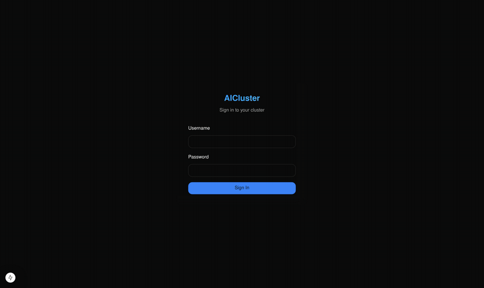
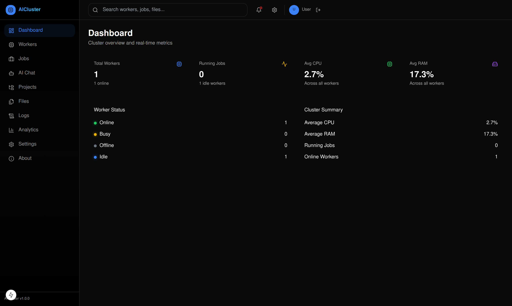
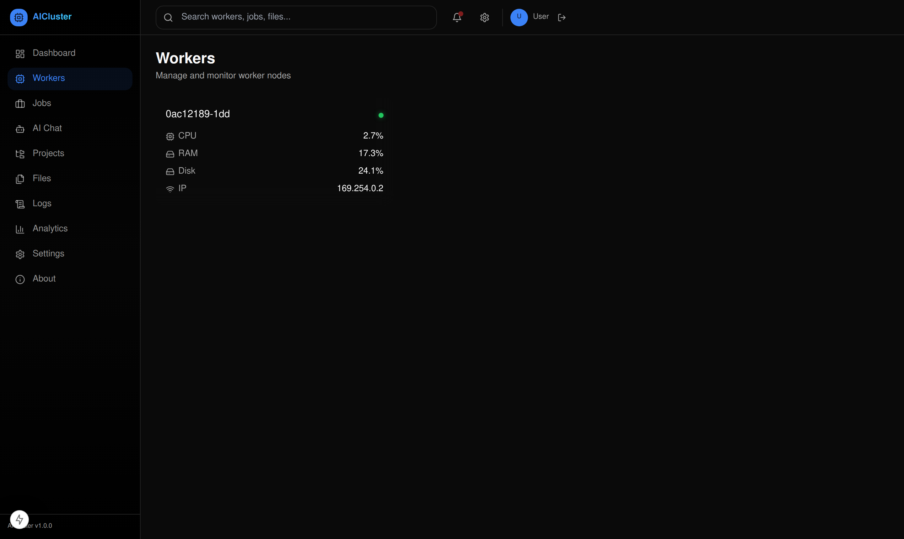
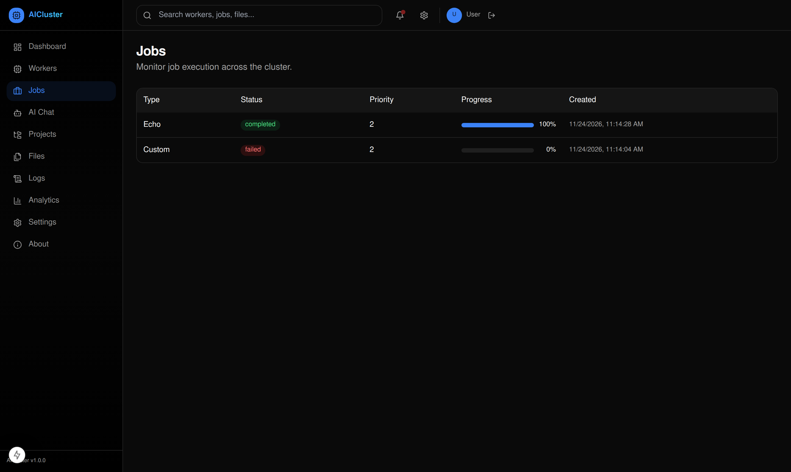
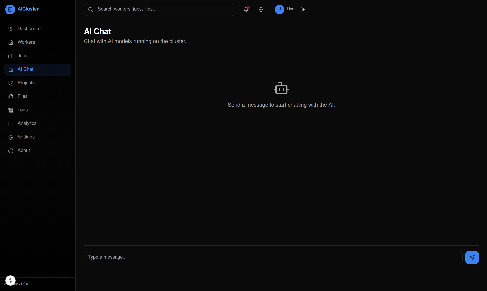
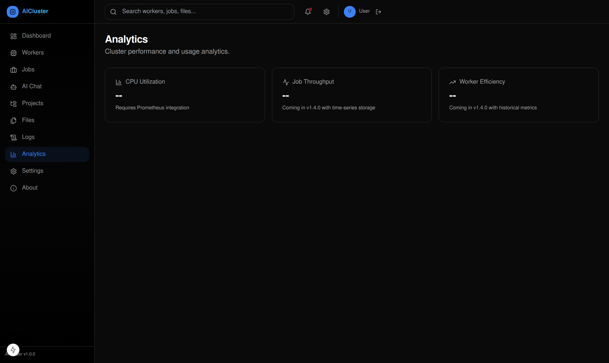
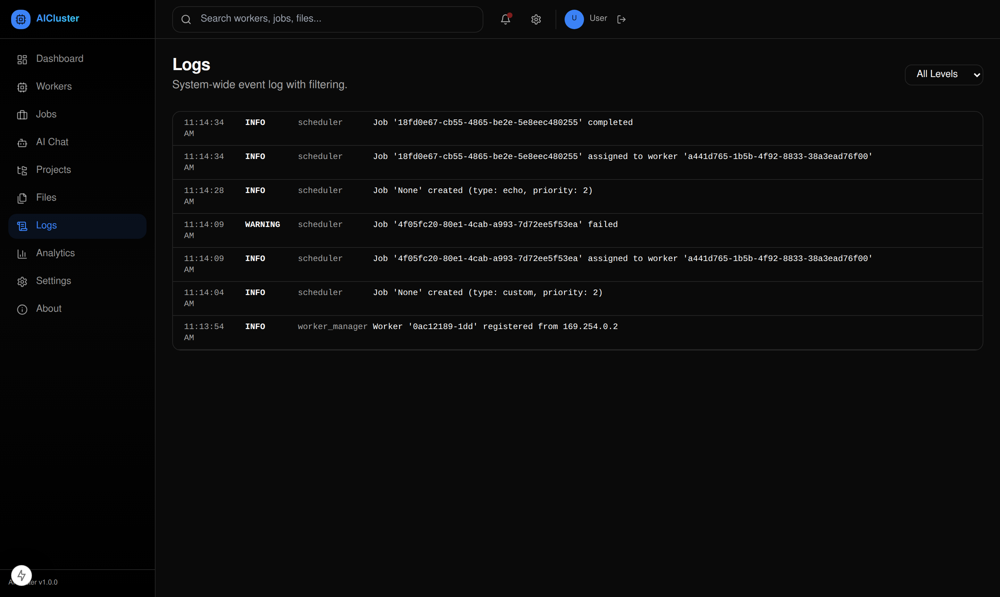

<div align="center">



# 🚀 AICluster v1.3.1

**Offline-first AI cluster management platform for distributed computing across Windows machines**

[](https://github.com/manojkumar12-maker/AICluster-Studio/releases)
[](SECURITY.md)
[](backend/tests/)
[](https://python.org)
[](https://nextjs.org)
[](docs/INSTALLATION.md)

</div>

---

## 🖼️ What it looks like

<div align="center">
<table>
<tr>
<td align="center"><b>📊 Dashboard</b><br/></td>
<td align="center"><b>👷 Workers</b><br/></td>
</tr>
<tr>
<td align="center"><b>📋 Jobs</b><br/></td>
<td align="center"><b>💬 AI Chat</b><br/></td>
</tr>
<tr>
<td align="center"><b>📈 Analytics</b><br/></td>
<td align="center"><b>📜 Logs</b><br/></td>
</tr>
</table>
</div>

---

## ✨ What is AICluster?

AICluster turns a room full of Windows machines into one managed AI cluster: a **master** server coordinates a fleet of **workers** that run distributed jobs, stream live telemetry and serve AI models — all over your LAN, with **no internet required** after setup.

| Area | Capabilities |
|------|-------------|
| **🔐 Security** | JWT auth on all 131 endpoints, bcrypt passwords, rate limiting, CORS enforcement |
| **🧠 AI Runtime** | Multi-provider (Ollama, llama.cpp, OpenAI-compatible), model routing, context optimization, chat sessions |
| **📦 Workflow Engine** | DAG-based task orchestration, parallel execution, exponential backoff retry, artifact store |
| **🤝 Multi-Agent** | 12 default agents, orchestrated pipelines, inter-agent communication, code review & merge |
| **🔌 Plugin System** | Plugin SDK with 16 hook types, lifecycle management, dynamic loading |
| **📊 Repository Intelligence** | Multi-language symbol parser, dependency graph, code metrics, full-text search |
| **🛠️ Engineering Engine** | Goal analysis, automated planning, quality gates, self-repair, documentation generation |
| **📋 Audit System** | Event capture middleware, 17 categories, search, CSV/JSON export, retention policies |
| **👷 Worker Fleet** | Distributed job execution, 21-state machine, auto-reconnect, async handlers |
| **🌐 Offline-First** | 100% LAN operation, no internet required after initial setup |

---

## 🏗️ Architecture

```
Master (FastAPI :8000)          Workers (FastAPI :8001+)
┌──────────────────────┐        ┌──────────────────────┐
│ REST API (131 routes)│        │ State Machine        │
│ WebSocket (JWT auth) │◄──────►│ Job Execution        │
│ Scheduler            │        │ Path Validation      │
│ AI Runtime           │        │ Async IO             │
│ SQLite Database      │        │ Auto-Reconnect       │
│ Rate Limiter         │        └──────────────────────┘
└──────────────────────┘
         │
         ▼
┌──────────────────────┐
│ Web Dashboard (:3000)│
│ Desktop Apps (Tauri) │
│ CLI (aicluster.exe)  │
└──────────────────────┘
```

---

## 🚀 Quick Start

> ⚡ First success in five minutes: one terminal for the master, one for a worker, one for the dashboard.

```powershell
# 1. Install Python 3.12+ and Node.js 18+
# 2. Clone
git clone https://github.com/manojkumar12-maker/AICluster-Studio.git
cd AICluster-Studio

# 3. Install dependencies
pip install -r backend/requirements.txt
pip install slowapi pytest pytest-asyncio httpx
cd frontend && npm install && cd ..

# 4. Start the Master (terminal 1)
cd backend
uvicorn app.main:app --host 0.0.0.0 --port 8000

# 5. Start the Dashboard (terminal 2)
cd frontend
npm run dev

# 6. Open http://localhost:3000 and sign in
#    On first start the master writes the generated admin
#    password to backend/data/admin_password.txt (0600).
```

Then add a worker machine (terminal 3, or another PC):

```powershell
cd worker
# set AICLUSTER_MASTER_SECRET to the master's backend/data/secret.key value
uvicorn app.main:app --host 0.0.0.0 --port 8001
```

Submit your first job and watch it run at http://localhost:3000 → **Jobs** ✅

📖 **[Full Installation Guide](docs/INSTALLATION.md)** — covers installer, portable, source, and production deployment.

---

## 🔐 Security Posture

| Severity | v1.3.0 | v1.3.1 |
|----------|--------|--------|
| CRITICAL | 4 | **0** |
| HIGH | 5 | **0** |
| Authentication | None | JWT on all endpoints |
| Worker Auth | None | Worker secret required |
| Rate Limiting | None | 100/min default |
| CORS | `*` allowed | Restricted to configured origins |

---

## 📚 Documentation

| Guide | Description |
|-------|-------------|
| [INSTALLATION.md](docs/INSTALLATION.md) | Complete installation guide |
| [QUICK_START.md](docs/QUICK_START.md) | 5-minute setup |
| [FIRST_CLUSTER.md](docs/FIRST_CLUSTER.md) | Multi-worker cluster setup |
| [DEPLOYMENT.md](docs/DEPLOYMENT.md) | Production hardening |
| [TROUBLESHOOTING.md](docs/TROUBLESHOOTING.md) | 45 common problems |
| [FAQ.md](docs/FAQ.md) | Frequently asked questions |
| [UPGRADING.md](docs/UPGRADING.md) | Upgrade from v1.3.0 |

---

## 🛠️ Technology Stack

| Layer | Technology |
|-------|-----------|
| **Backend** | Python 3.12+, FastAPI, SQLAlchemy 2.0, Pydantic V2 |
| **Database** | SQLite (via aiosqlite) |
| **Frontend** | Next.js 15, React 18, TypeScript, TailwindCSS |
| **Desktop** | Tauri v2 (Rust + React) |
| **State** | Zustand, TanStack React Query |
| **AI** | Ollama, llama.cpp, OpenAI-compatible |
| **Auth** | JWT (python-jose), bcrypt |
| **Packaging** | PyInstaller, Inno Setup 6 |
| **Testing** | pytest (backend + worker), Vitest |

---

## 📁 Directory Structure

```
AICluster/
├── backend/               # FastAPI master server (Python)
│   ├── app/               # Application code (15+ subsystems)
│   ├── tests/             # Backend pytest suite
│   └── data/              # Runtime database, secret.key, admin password
├── worker/                # Worker agent (Python)
│   ├── app/               # Worker application code
│   └── tests/             # Worker pytest suite
├── frontend/              # Next.js 15 dashboard
├── studio/                # Tauri v2 desktop IDE
├── master-control-center/ # Tauri cluster management app
├── worker-control-center/ # Tauri worker management app
├── build/                 # Build system & verification
├── scripts/               # PowerShell & Python tools
├── config/                # YAML configuration
├── shared/                # Shared types & protocols
├── docs/                  # Documentation (8 guides)
├── dist/                  # Built executables
├── VERSION                # 1.3.1
└── CHANGELOG.md           # Release history
```

---

## ✅ Build

Executables are built using PyInstaller:

| File | Size | For |
|------|------|-----|
| `AIClusterMaster.exe` | ~250 MB | Master server machine |
| `AIClusterWorker.exe` | ~52 MB | Each worker machine |
| `aicluster.exe` | ~30 MB | CLI (optional) |

All in `dist/` organized by role.

---

## 📋 Requirements

| Component | Minimum | Recommended |
|-----------|---------|-------------|
| **OS** | Windows 10 22H2 | Windows 11 Pro |
| **CPU** | 4 cores (i5) | 8+ cores (i7/Ultra) |
| **RAM** | 16 GB | 32-64 GB |
| **Disk** | 10 GB SSD | 50 GB NVMe |
| **Python** | 3.12 | 3.12 |

---

## 🆘 Troubleshooting quick hits

- **Worker shows 401 on register** — set `AICLUSTER_MASTER_SECRET` on the worker to the master's `backend/data/secret.key` value, then restart the worker.
- **Forgot the admin password** — delete `backend/data/aicluster.db` and restart the master; a new password is written to `backend/data/admin_password.txt`.
- **Dashboard can't reach the API** — the frontend proxies `/api/:path*` to `:8000`; make sure the master is running.

See [TROUBLESHOOTING.md](docs/TROUBLESHOOTING.md) for 45 more.

---

## 🤝 Contributing

See [CONTRIBUTING.md](CONTRIBUTING.md) and [SECURITY.md](SECURITY.md).

---

## 📄 License

AICluster is © 2026 Manoj Kumar Mathangi. All rights reserved. See [NOTICE.md](NOTICE.md).

---

<div align="center">
Made with ❤️ by the AICluster Contributors
</div>
